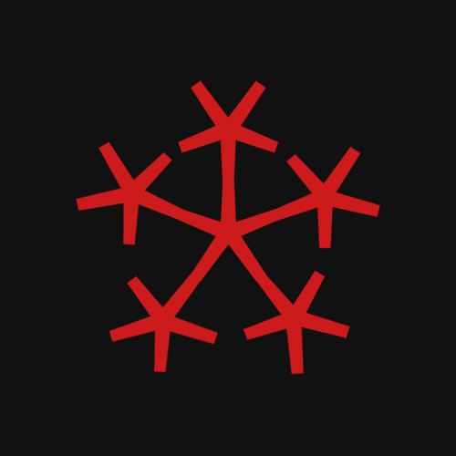

<h1 align="center">RedNix</h1>

<div align="center">
  <br>
  Offensive security toolkit as a Nix flake
</div>

## What is this

RedNix is a reproducible offensive-security toolkit. 
It is a plain Nix flake: every tool is pinned by `flake.lock`, grouped into categories, and exposed two ways - as per-category dev shells and as individually runnable packages.

Supported systems: `x86_64-linux`, `aarch64-linux`, `aarch64-darwin`.

You need Nix with flakes enabled, I recommend to use the [Determinate Nix installer](https://github.com/DeterminateSystems/nix-installer), especially if you're on macOS

## Quick start

Drop into a shell with the entire toolkit (large download on first run):

```sh
nix develop github:redcode-labs/RedNix
```

Or just one category (see the table below; one category per shell):

```sh
nix develop github:redcode-labs/RedNix#web
```

Run a single tool without installing anything:

```sh
nix run github:redcode-labs/RedNix#nmap -- -sV target.example
```

Install a tool into your user profile:

```sh
nix profile install github:redcode-labs/RedNix#ffuf
```

Build the whole toolkit as one environment (also serves as a smoke test that
every package in the set builds):

```sh
nix build github:redcode-labs/RedNix
```

## Categories

Each category is a dev shell (`nix develop .#<category>`) and a key in
`packagesByCategory`. Entering a shell prints its tool count.

Categories:

RCL, archive-tools, bluetooth, ci, cloud, containers, crypto, dns,
email, exploits, forensics, fuzzers, general, git, hardware, ids,
info-gathering, kubernetes, ldap, load-testing, misc, mobile, network,
packet-generators, passwords, port-scanners, protocols, reporting,
reverse-engineering, services, smartcards, snmp, sql, ssh, ssl-tls,
supply-chain, terminals, terraform, traffic, tunnels, unported-shims,
voip, vuln-analysis, web, windows, wireless.

## For downstream flakes

- `packagesByCategory.<system>` - `{ <category> = [drv ...]; }`, already filtered for platform availability. Use this when you want category-shaped data without the `mkShell` wrapping (e.g. to expose a subset of categories in your own NixOS module).
- `packages.<system>` - flat, pname-keyed attrset of every tool, plus `default` (a `buildEnv` aggregate of everything).
- `checks.x86_64-linux.no-silent-drops` - eval-time tripwire that fails when a declared package silently vanishes from every system.


## Platform notes

- `aarch64-darwin` gets the same package set as Linux, minus entries listed in `darwin-skip.nix` (packages whose darwin build is broken upstream) and minus Linux-only sources such as nix-alien.
- `x86_64-darwin` is **NOT** supported - nixpkgs sunsets it after 26.05, macOS 27 drops support for Intel Macs. It's been 6 years since Apple Silicon came out, enough of time to upgrade.

## MicroVM

Boots the toolkit as an isolated NixOS VM. The guest is always Linux; Linux hosts use KVM and `aarch64-darwin` uses qemu with HVF acceleration (by default).

```sh
nix run github:redcode-labs/RedNix#microvm
ssh rednix@127.0.0.1 -p 2222   # password: rednix
```

SSH (host 2222 to guest 22) and HTTP (8080 to 80) are bound to loopback, so the VM is reachable only from the host. `/home/rednix` persists on an auto-created ext4 image in the working directory; the rest of the guest is stateless (read-only store share plus tmpfs).

Evaluation needs nothing special, which is why CI checks every host. Building is another matter, because the guest is a Linux derivation even when the host is darwin.

## Building it yourself

### The toolkit

```sh
nix build --dry-run .#devShells.<system>.default    # size the job first
nix build --keep-going --no-link .#devShells.<system>.default
```

Always pass `--keep-going`: it collects every failure in one pass instead of stopping at the first, and failed build logs stay retrievable afterwards with `nix log /nix/store/<hash>.drv`. Expect roughly 30 GiB unpacked for a full platform.

### The microVM

Run it from a scratch directory, not the repo. The runner writes `control.socket` and the persistent `rednix-home.img` to the working directory, and a stale socket breaks later evaluation - Nix cannot copy a unix socket into the store (errored for me during my testing).

```sh
mkdir -p ~/rednix-run && cd ~/rednix-run
nix run /path/to/rednix#microvm
ssh rednix@127.0.0.1 -p 2222        # password: rednix
```

The home image declares 64 GiB but is sparse (`truncate` + `mkfs.ext4`), so a fresh one occupies about 1.5 GiB. It is created once on first boot; growing it later means `resize2fs`, so the generous default is deliberate.

Shut down cleanly through the QMP socket rather than killing qemu:

```sh
printf '{"execute":"qmp_capabilities"}\n{"execute":"system_powerdown"}\n' \
  | nc -U control.socket
```

On Linux hosts you need access to `/dev/kvm`. 

Under WSL2, enable `nestedVirtualization=true` in `.wslconfig`, then add yourself to the `kvm` group.

### Linux outputs on macOS

`aarch64-darwin` evaluates every output, but the microVM guest and any Linux-only package are Linux derivations a macOS host cannot build alone. Another reason to use Determinate Systems Nix on macOS is the fact that it provides such Linux builder [ref](https://docs.determinate.systems/determinate-nix/linux-builder/).

Reclaiming afterwards: `nix build` with `--out-link` creates a GC root, so remove the link before `nix store gc` or the space stays held. A builder VM's disk is a file on the host, so `nix-collect-garbage -d` *inside* it must be followed by `sudo fstrim /` to return the blocks to the host.

## Unported tools: nix-alien escape hatch

Pentest work involves stuff that assume FHS paths (`/lib64`, `/usr/lib/...`) which Nix systems don't provide. The `unported-shims` category ships [nix-alien](https://github.com/thiagokokada/nix-alien) (Linux-only), which patches the dynamic linker and library paths at invocation time so such binaries run without writing a derivation:

```sh
nix run github:redcode-labs/RedNix#nix-alien -- <path/to/elf>
```

## Troubleshooting a broken package

If `nix build .# --keep-going` reports a broken dependency that isn't itself in the package list, find which top-level tool pulls it in:

```sh
nix why-depends --derivation .# nixpkgs#<broken-dep>
```

`--derivation` works without building anything. This tells you which category or shell is pulling in the broken dep.

### Checking whether a package supports your platform

```sh
# 1. does it evaluate for that system?
nix eval --raw nixpkgs#legacyPackages.aarch64-darwin.pspy.drvPath

# 2. did hydra manage to build it? 200 = yes, 404 = no
out=$(nix eval --raw nixpkgs#legacyPackages.aarch64-darwin.pspy.outPath)
curl -sf -o /dev/null -w '%{http_code}\n' \
  "https://cache.nixos.org/$(basename "$out" | cut -d- -f1).narinfo"

# 3. does it build for you?
nix build --dry-run nixpkgs#legacyPackages.aarch64-darwin.pspy
```

## Credits & license

- [Kalinix](https://github.com/balsoft/kalinix) by balsoft - an imperative take on the same problem that influenced this project.
- [nix-security-box](https://github.com/fabaff/nix-security-box) by fabaff - the package and category structure here owes a lot to it.
- [pwndbg](https://github.com/pwndbg/pwndbg) and
  [nix-alien](https://github.com/thiagokokada/nix-alien) - upstream package sources wired in as flake inputs.
- applePrincess/hackpkgs and served as package sources in earlier versions.

Licensed under the [ISC License](./LICENSE), © 2021 Red Code Labs.
